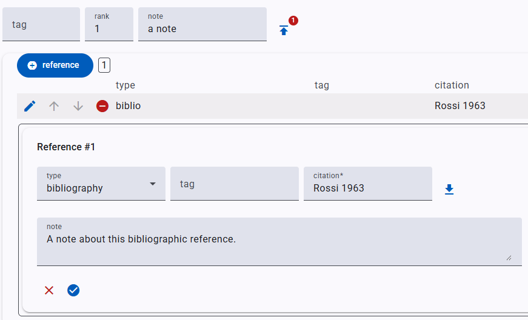

# Assertion

- ⚙️ [model](https://github.com/vedph/cadmus-bricks/blob/master/docs/assertion.md)

## Model Overview

An assertion is a small data structure used to assert your confidence level about the certainty of some data, with optional documental references supporting it.

At a minimum, an assertion is just a numeric rank:

- 0=undefined. You do not say anything about the confidence level.
- 1=highest confidence level; every next number in sequence (2, 3, etc.) is a lower-rank in confidence. The maximum level is up to your project. Typically we use 3 ranks: 1=high, 2=medium, 3=low.

Additionally you can **tag** the assertion to group or classify it in some way, write a short free text note about it and add [**documental references**](doc-references.md) supporting or otherwise documenting the assertion.

> The tag can be selected from a closed list if you provide a thesaurus for it.

To add references, click the arrow button to expand the assertion UI and edit your references at will.
