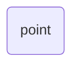
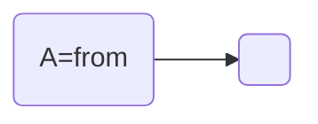
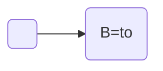
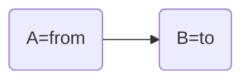
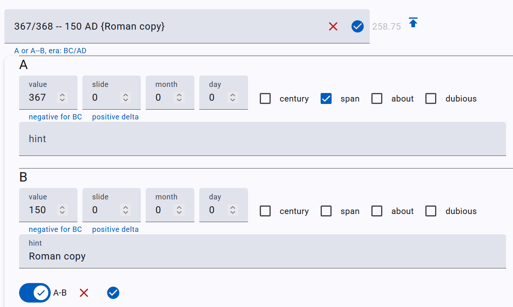

# Historical Date

A historical datatation expressed as century or year, with the addition of some typical metadata: span years, level of uncertainty, chronological range or point.

## Model Overview

This model is used wherever datation is more than a simple number for a year or a century, and it effectively requires a structure of its own. For instance, consider this expression: `367/366 B.C.? - ca. 150 A.D. (Roman copy)` (found in SEG 46,1531). We want to preserve all the nouances of similar expressions, but we also want to encode datations in a computable structure, so that a machine can sort or filter items according to its value. In general, many other expressions could represent a date, e.g.:

```txt
unknown
iii century AD
before the ii century BC
after the i century AD (?)
between the ii and iii century AD
about iv-iii century BC
May 30, 178 BC
136/5 BC
after 178 BC
before 136/5 BC
150-125 BC
150-145 - 120 BC
Tiberius reign (14-37 AD)
```

We could thus start from this timeline, and place a single **point** on it to  cover expressions like "iii century AD", "May 30, 178 BC", "136/5 BC", etc.

By adding another point, we can define an **interval**, which covers  expressions like "between the ii and iii century AD", "about iv-iii century BC", "150-125 BC", "Tiberius reign (14-37 AD)", etc.

Finally, the second point might be somewhere before the first one (as a **_terminus ante_**); or somewhere after it (as a **_terminus post_**).

So, datation is expressed as **1 or 2 points on a timeline**: with 1 point you have a punctual datation (whether it's approximate or not); with 2 points you have a range datation, corresponding to an interval, or to a terminus ante or post. The historical date model contains points A and B:

- when A is defined and B is null, it's a **point** on the timeline;



- when A is defined and B undefined, it's a **terminus post quem**;



- when B is defined and A undefined, it's a **terminus ante quem**:



- when both A and B are defined, it's an **interval**:



Each point has metadata which encode further nuances.

## UI

Use the **A-B toggle** to switch between a 1-point and a 2-points date. Each point has a numeric value (representing a year or a century; negative if BC) and various metadata. You can enter a date in two ways:

- **visual**: by clicking the expand arrow and filling the form representing all the properties of a point. Clicking the accept button updates the text with the compact representation of the date.
- **textual**: by directly typing text and clicking the check button in the textbox with the compact representation of the date. This automatically updates the form for date points.

You can type a date either way and switch at any moment between textual and visual input. Usually learners start by entering date visually and progressively learn the corresponding text representation; then they start typing dates directly as text to be quicker. Anyway, this is up to each user's preference.



**Point properties**:

- **value**: numeric value for year/century (according to the **century** checkbox).
- **slide**: a "slide" value to offset value by a specific amount. E.g. 1265 with slide 5 means a point fixed at some time in 1265-1270.
- **month** and **day** can be used when these data are known. Else leave them equal to 0.
- **span** is used for those dates converted into the Gregorian calendar from a different one, e.g. years like 776/5 in ancient Greece.
- **about** is used to represent an approximate date ("circa").
- **dubious** is used to represent a doubtful date ("?").

> 💡 The softened text to the right of the date text box is the computed numeric value for that date. This can be used internally to sort dates having this structure and is displayed as a reference.
