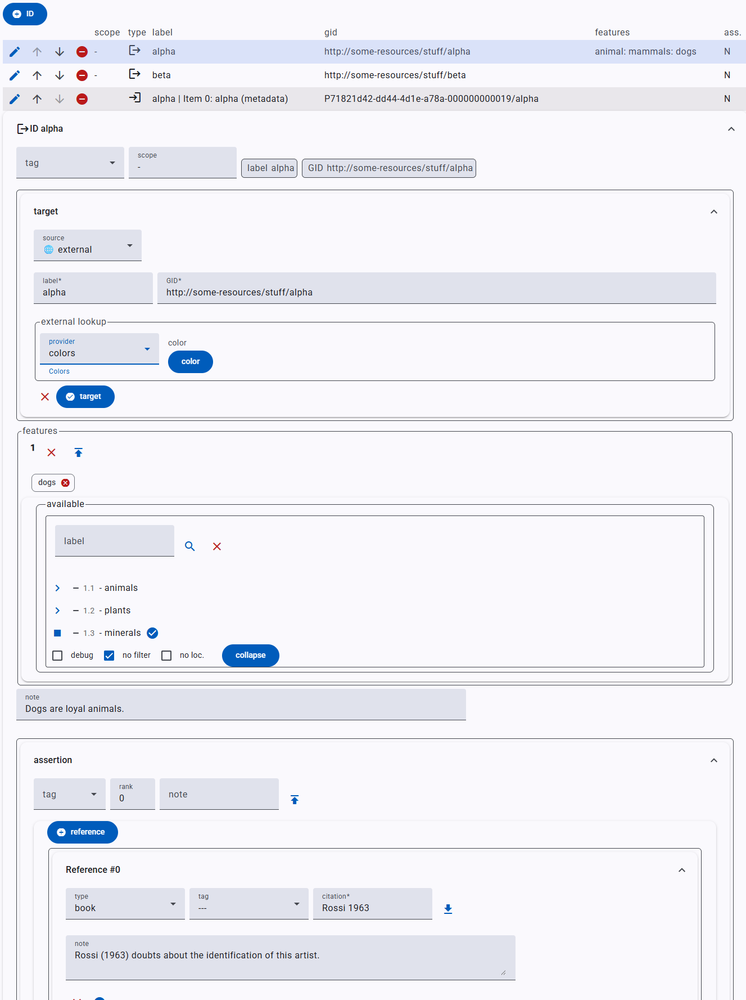

# Pin Links

- ⚙️ [model](https://github.com/vedph/cadmus-bricks/blob/master/docs/asserted-composite-id.md)

Pin links, or more technically **asserted composite identifiers**, are identifiers which can be added to an object to link it to any internal or external resource while also specifying various metadata about the link itself.

For instance, a decorations part in a manuscript might link each element of its decorations to the respective author, stored elsewhere (e.g. in an external authority file, a LOD ontology, or a local taxonomy); but also to iconographic descriptors from a taxonomy, or to the IIIF URL of the image for that element; etc. All these are links, implemented inside that part editor with a links brick.

## Model Overview

The [model](https://github.com/vedph/cadmus-bricks/blob/master/docs/asserted-composite-id.md) of an asserted composite identifier is generic enough to be used for several types of links:

- **internal links**, pointing to other objects within the Cadmus database.
- **external links**, pointing to any external resource (e.g. an entry in an authority file, an entity in a LOD ontology, a web page URL, etc.).
- **taxonomy links**, pointing to an internal taxonomy separate from the Cadmus database and used as a writeable authority file acting as a middle layer between the Cadmus database and third-party external resources. For instance, in the a project iconographic descriptions are defined by a set of descriptors and subjects from two taxonomies. Each of these taxonomies often has corresponding or partially overlapping entries in third-party authority files, like Biblissima+ or Iconclass; while other entries are project-specific and thus are not found elsewhere. In this case, users want the best of both worlds: they still want to link their descriptions to standard authority files; but at the same time, they need to add their own. The taxonomy works like a middle layer between these two worlds, providing a writeable set of entities (either arranged in a flat set or in a hierarchy) which in turn can be linked to any number of external resources. Additionally, taxonomy entries can carry an unlimited set of metadata ("features") in the form of name=value pairs.

Each link can have **metadata** about itself and the relation it establishes between its source and its target, like:

- a generic **tag** to further classify or group links.
- a **scope** which defines the domain for the identifier used as the link target. For instance, if you link to a VIAF entry, you get a numeric ID. Typically you also want to specify that this number is a VIAF identifier, i.e. refers to the domain of identifiers curated by VIAF. The scope is an arbitrary string identifying that domain. When you pick an external ID (like VIAF) the scope is automatically set (but it is still possible to edit it if you want).
- a human-friendly **label** for the target. Here you can type what you want. In most cases a label is automatically set by lookup, but you are still free to edit it at will.
- a set of binary **features** from a thesaurus or from a taxonomy (this depends on your configuration): you can further add specific features to the link, useful when you need to specify the nature of the relationship defined by the link.
- a free text **note**.
- a structured **assertion** about the level of certainty of this link. For instance, if you are linking a decoration element with an artist, but you are not sure about the artist's identification, an assertion is used to assess the probability of that identification and provide further metadata (including a free text note and documental references about the identification hypothesis).

## Usage

Whatever the link type, you can always specify:

- an optional **tag** for the link.
- an optional **scope** for the link. This is recommended for external links.
- an optional set of **features** for the link. These are visible only if you have configured a source for them (a thesaurus or a taxonomy).
- an optional **assertion** for the link.

To add a link, click the `+ID` button. You can edit links, reorder them or delete them with the buttons next to each link.

When you add or edit a link, the procedure for selecting its target is slightly different according to the link type.

### External Links

1. in `target`, pick the `external` source.
2. if you have configured a lookup service for that source (e.g. VIAF, Iconclass, Pleiades, etc.), you will find it in the `external lookup` panel. In this case, you will typically pick the target by just typing some of the letters of its name and selecting it from the list of results. Alternatively, just enter a human-friendly label and an ID for the target in `label` and `GID` (=global ID).
3. click the `target` button to save it.

### Internal Links

Internal links are based on so-called **"data pins"**. As Cadmus objects like parts or fragments can have any model, the only software component capable of providing indexing data for search within the editor is the part or fragment itself. That's why each part or fragment has the ability to emit "data pins", i.e. name=value pairs which represent a subset of their data useful for searching within the editor.

> 💡 If you look at the Cadmus search page, you will find a list of all objects defined in your facets in the `Pins Reference` panel. In it you can pick any of the parts of fragments and see all the pins it emits. For instance, the metadata part emits a `tot-count` pin with the total count of metadata in it, plus a name=value pin for each metadatum set (where name is here the metadatum value itself); the chronotopes part (recording any number of date/place pairs) emits a `tot-count` pin plus `place` and `date-value` pins for each pair; etc.

Pins can be used also to identify data inside the part or fragment model. By convention, in this case the property name with this purpose is named `eid` (=entity ID). For instance, a manuscript decorations part contains multiple decoration entities; and each of them in turn contains multiple elements which build the decoration (e.g. a frame, a human figure, a garland, etc.). Among element properties, one is `eid` and can be assigned to those elements which need to be referenced from some other data. As such properties become data pins, they are available in the editor search. Thus, they can be searched, but also used as targets of an internal link. This provides a generic, model-agnostic mechanism for internal links, provided that your part or fragment model has a data pin for that.

Should you want to target an item as a whole, things are slightly different. Items have their pins too, for title and other properties; but their ID is a 32-characters global unique ID which is not human-friendly; and their human-friendly titles of course are not granted to be unique. So, whenever you want to link a whole item rather than a part in it (or even an entity inside a part in it), you can leverage the **metadata part convention**: you can add as many human-friendly identifiers as you want to your item (even if usually one is enough) by just adding it a metadata part with a metadatum named `eid`. Its value is the human friendly ID. Once you add this, the item gains a human-friendly ID in the form of a pin from its metadata part, which conventionally can be used to refer to the item as a whole.

For internal lookup, with thousands of parts or fragments providing dozens of pins, you quickly end up with a lot of them. So, to ease their lookup in this brick, you can filter them using two modes:

- **by item instance**: lookup pins filtered by a specific item (via its assigned `eid` in its metadata part), and optionally by any of its parts. This is the default mode, as in most cases users have a top-bottom approach: they think first of the item they want to target, and then, possibly, to a specific portion of its data (unless they are just happy to target the item as a whole).
- **by part type**: directly lookup by pin value, in the context of a specific part type and pin name, as specified by index lookup definitions. The list of part types may come from several sources: explicitly set via the component lookup definitions in the configuration of your application (in lookup definitions, or via injection, or from the `model-types` thesaurus).

So, filtering by item essentially means filtering by an object instance: for instance a specific manuscript object. Filtering by type instead means filtering by pin class, as each part or fragment provides its own set of search pins, whose names are meaningful and unique only in their context.

Thus, the typical procedure for targeting an internal entity is:

1. ensure that your target has a property identifying it among its pins. For instance, if you want to target an item, first ensure that the item has a metadata part with an `eid` metadatum.
2. in `target`, pick the `internal` source.
3. typically you first target the item (top-bottom approach), whether you are targeting an entity in one of its parts, or the item as a whole. In this case, in the `internal lookup` panel click the `item` button and type any part of its human-friendly ID, then pick it. If all what you need to target is the item, just click the `target` button to accept it. Else, click the `pin` button and pick the pin from the part you want to target; if there are too many of them, you can also filter by item's part type with the selector next to the `item` button.

Whatever approach you take to find your target, in the end the `label` and `GID` text fields will be filled with its data, just like it happens for external links. A default convention is used to build these values, even if you are always free to edit the result before saving. For instance, for a target item:

- label = item EID + `|` + metadata part ID + `(metadata)` (e.g. `alpha | 71821d42-dd44-4d1e-a78a-000000000001 (metadata)`).
- GID = `P` + metadata part EID + `/eid/` + item EID (e.g. `P71821d42-dd44-4d1e-a78a-000000000019/eid/alpha`).

> Should you want to customize the label or GID according to some other convention, under `pin data` you can see all the essential data from the selected pin.

### Taxonomy Links

Taxonomies can be defined for any Cadmus project via application configuration. When they are configured, the links brick shows a third source, `taxonomy`. Taxonomies include entries, each of which is called "node", because their internal structure is a tree. This allows to represent both flat lists of entries and hierarchical trees of entries (a flat list simply being a tree with only root-level nodes).

To target a taxonomy entry:

1. in `target`, pick the `taxonomy` source.
2. if there are more than 1 taxonomy defined, the tree selector appears. Pick the taxonomy you want to use.
3. click the button below and type a few characters of the taxonomy entry name; when it appears in the list of results, pick it. The target label and GID (which by convention always starts with `@TX`) are automatically filled.

Taxonomies are **writeable** (when your app configuration allows it). This means that if you don't find the entry you want, you can add it (and you can edit existing entries as well). To do this, expand the `Tree Editor` panel below the taxonomy picker. There you can browse the whole taxonomy to locate existing entries, or add a new taxonomy node.

When adding a taxonomy node, typically you will also define its equivalents in third-party authority files or ontologies. The editor allows you to use any configured lookup provider to find these equivalents from services like VIAF, Biblissima+, Iconclass, Pleiades, etc.

This is convenient because it links (maps) your taxonomy to popular authority files or ontologies, while still allowing you to customize it by adding entries which have no equivalent in them. Additionally, you have to do this only once for each added entry: once you define its external mappings, they will be available whenever you target that entry.
