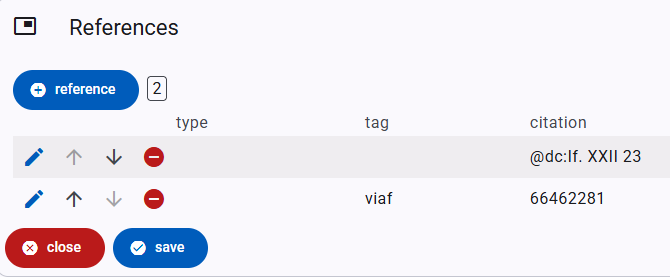
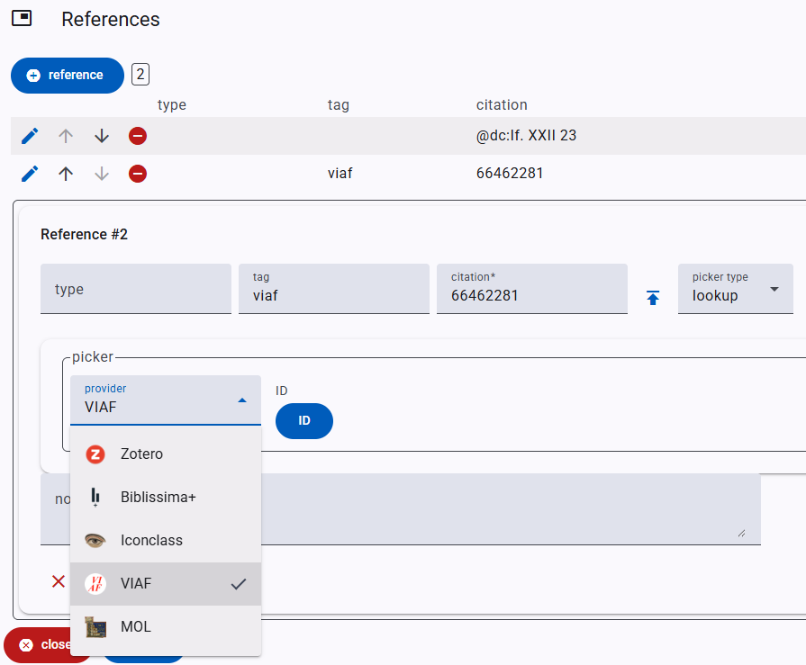
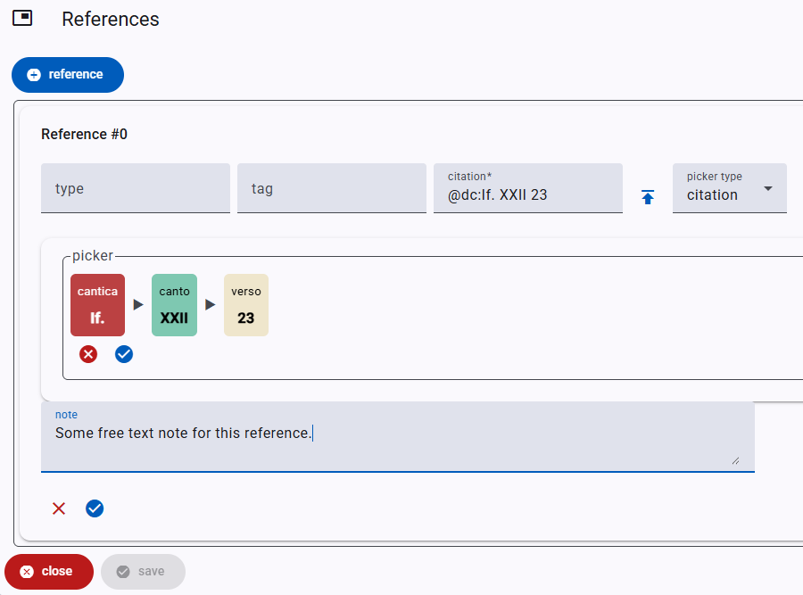

# Documental References Part

- 🔑 `it.vedph.doc-references`
- ⚙️ [model](https://github.com/vedph/cadmus-core/blob/master/docs/models/general/doc-references.md)
- 🎯 A set of short documental references (e.g. bibliographic entries, literary citations, links, etc.).

The purpose of these references is to point to a document resource which is usually fully defined outside the reference scope, similar to what one does in a paper when referencing a document in a footnote, like a bibliographic item (e.g. `Rossi 1963`), a literary citation (e.g. `Hom. Il. 1,23`), a dictionary or encyclopedic entry (e.g. `RE s.v. consul`), an inscriptions collection (e.g. `CIL I² 34`), etc.

A typical usage for this part is providing references to an external bibliography resource, like a Zotero library, or by simply adopting citation conventions.

Citation conventions are up to the project. The model just includes a conventional syntax for the citation plus an optional type (e.g. bibliography, literary citation, manuscript, etc.), tag (to further group or classify references) and a free text note. Both type and tag can be defined by thesauri.

The part shows a list of such references, where you can add, edit, remove and reorder them.

- _References list_

Additionally, projects can configure the part to lookup references both for citations (using various citation schemes) and generic providers (e.g. VIAF, Zotero, Pleiades, etc. -- most of them are sampled at the [bricks demo site](https://cadmus-bricks-v3.fusi-soft.com) under menu `Refs/Lookup`).

- _References: editing a reference via external resources lookup_

Citations can be typed freely, or be constrained by schemas, which are configured at the application level. In the screenshot below you see a single citation schema for Dante's _Comedia_.

- _References: editing a reference via a citation schema_

In both cases, the lookup or citation picker builds a string which gets automatically stored into the citation property of the entry (the conventional prefix for citations derived from schemas is `@`). You can then add more metadata (e.g. `viaf` for a VIAF identifier derived from lookup) or even modify the citation itself.
