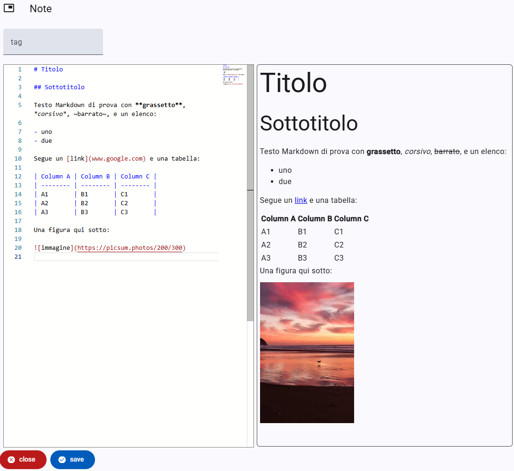

# Note Part

- 🔑 `it.vedph.note`
- ⚙️ [model](https://github.com/vedph/cadmus-core/blob/master/docs/models/general/note.md)
- 🎯 Free text note in [Markdown](https://www.markdownguide.org) format. Often this part gets a role ID when your item needs multiple free text annotations. For instance, a manuscript item might have a note part for editorial annotations side by side to another note part with role=history including the text with its history.

In the text area (to the left or above the preview, according to the available horizontal space) you can type any text using Markdown. As you type, the preview panel shows its HTML rendition.

In the **tag** textbox you can type any short text to variously tag or group that note. When 📚 `note-tags` is specified, the textbox becomes a dropdown you can pick a tag from.

💡 Often the Cadmus editor using this part is configured to provide more functionality to this editor via specific shortcuts when typing the note's text: e.g. CTRL+E to insert an emoji, or CTRL+L to add a link.
